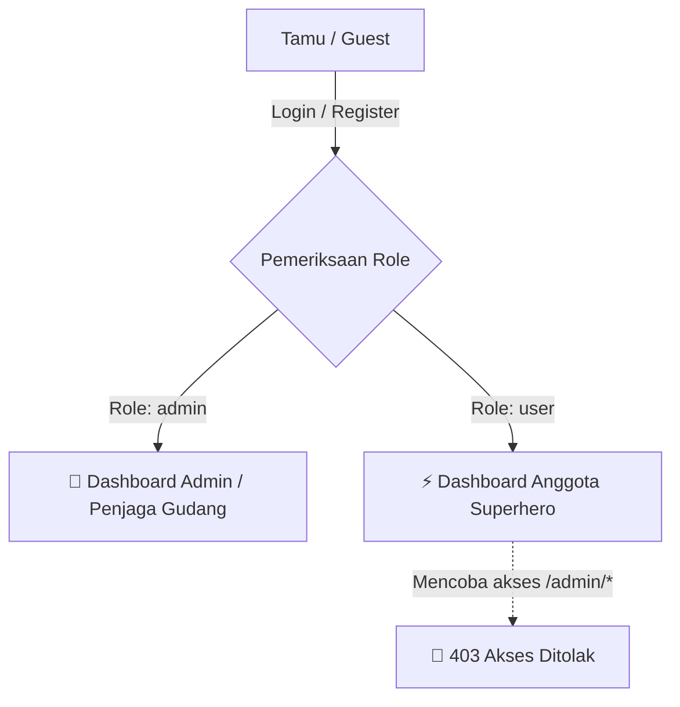
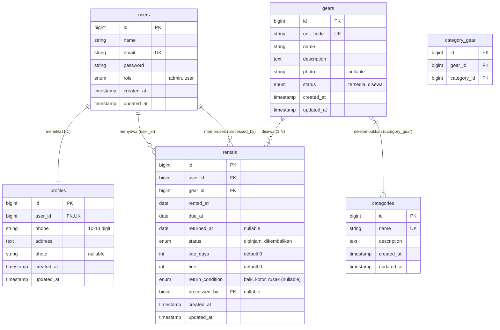

# 🦸 HeroVault

**Sistem Peminjaman Kostum dan Senjata Superhero Pensiunan Kota Metrodana**

[](https://php.net)
[](https://laravel.com)
[](https://mysql.com)
[](https://tailwindcss.com)
[](https://vitejs.dev)

---

## 📖 Tentang HeroVault

**HeroVault** adalah aplikasi web modern berbasis **Laravel** yang dibangun untuk mengelola operasional peminjaman dan penyewaan persenjataan, kostum, serta gawai legendaris milik pahlawan super yang telah pensiun di **Kota Metrodana**.

Warga biasa dan penggemar kini dapat menyewa peralatan superhero legendaris (seperti Jubah Terbang, Palu Petir KW, Topeng Kelelawar, dan Perisai Bundar) secara terstruktur untuk keperluan cosplay, pembuatan film, lomba perayaan, atau sekadar gaya.

Aplikasi ini menggantikan pencatatan manual buku fisik gudang yang rawan kesalahan dengan sistem otomatisasi:
- Mencegah konflik sewa ganda (hanya 1 transaksi aktif per unit).
- Pembatasan kuota peminjaman anggota (maksimal 2 sewa aktif).
- Perhitungan jatuh tempo dan kalkulasi denda otomatis per hari keterlambatan.
- Rekam medis kondisi fisik perlengkapan saat dikembalikan.
- Rekap riwayat transaksi penyewaan lengkap dengan fitur cetak laporan ramah printer.

---

## 📑 Daftar Isi

- [Fitur Utama](#-fitur-utama)
- [Hak Akses & Peran Pengguna](#-hak-akses--peran-pengguna)
- [Aturan Bisnis & Perhitungan Denda](#-aturan-bisnis--perhitungan-denda)
- [Teknologi yang Digunakan](#-teknologi-yang-digunakan)
- [Struktur Database & ERD](#-struktur-database--erd)
- [Panduan Instalasi & Menjalankan](#-panduan-instalasi--menjalankan)
- [Akun Demo untuk Pengujian](#-akun-demo-untuk-pengujian)
- [Skenario Pengujian (UAT)](#-skenario-pengujian-uat)
- [Struktur Direktori Proyek](#-struktur-direktori-proyek)
- [Tim Pengembang](#-tim-pengembang)

---

## ✨ Fitur Utama

Sesuai dokumen spesifikasi kebutuhan perangkat lunak (PRD v1.0), seluruh kebutuhan fungsional telah diimplementasikan:

| Kode | Fitur | Keterangan |
| :--- | :--- | :--- |
| **F-01** | **Registrasi Anggota** | Calon anggota mendaftar mandiri. Akun user dan data profil (`phone`, `address`) dibuat sekaligus dalam 1 proses. |
| **F-02** | **Login & Logout** | Autentikasi aman berbasis role: Admin langsung ke Dashboard Admin, Anggota ke Dashboard Anggota. |
| **F-03** | **Profil Saya** | Pengguna (Admin & Anggota) dapat melihat dan memperbarui nama, nomor HP, alamat, foto profil, dan kata sandi. |
| **F-04** | **Dashboard Interaktif** | **Admin:** 5 Kartu statistik gudang (total barang, tersedia, disewa, anggota, sewa telat).<br>**Anggota:** Sapaan pahlawan, kuota sewa (`x / 2`), dan pengingat jatuh tempo terdekat. |
| **F-05** | **Kelola Perlengkapan** | CRUD perlengkapan superhero. Mendukung kode unit unik, relasi multi-kategori, upload foto, dan proteksi penghapusan saat disewa. |
| **F-06** | **Kelola Kategori** | CRUD kategori kemampuan/fungsi peralatan dengan validasi nama unik. |
| **F-07** | **Kelola Anggota** | CRUD data akun & profil anggota dengan proteksi penghapusan jika anggota masih memiliki sewa aktif. |
| **F-08** | **Pencarian Perlengkapan** | Pencarian katalog berdasarkan nama barang (misal: pencarian *"Jubah"* otomatis menampilkan `JB-01` dan `JB-02`). |
| **F-09** | **Sewa Perlengkapan** | Anggota dapat menyewa langsung tanpa persetujuan manual, selama barang *tersedia* dan kuota aktif `< 2`. |
| **F-10** | **Perlengkapan Saya** | Daftar sewa milik anggota yang login (dilengkapi status, jatuh tempo, denda, dan catatan instruksi tanpa tombol pengembalian). |
| **F-11** | **Perlengkapan Disewa** | Monitoring seluruh sewa aktif oleh Admin dengan penanda visual **Terlambat (x Hari)**. |
| **F-12** | **Proses Pengembalian** | Admin memverifikasi tanggal kembali dan kondisi barang (`baik`, `kotor`, `rusak`). Sistem menghitung hari terlambat & denda otomatis. |
| **F-13** | **Riwayat & Cetak Laporan** | Filter riwayat sewa berdasarkan rentang tanggal, anggota, dan status. Halaman khusus cetak tanpa navbar siap cetak browser/PDF. |
| **F-14** | **Validasi Form Server-side** | Seluruh validasi data diproses di server dengan pesan kesalahan interaktif berbahasa Indonesia di bawah tiap field. |

---

## 👥 Hak Akses & Peran Pengguna

Sistem dilindungi oleh middleware role (`admin` dan `user`):



1. **Tamu (Belum Login):**
   - Hanya dapat mengakses halaman login (`/login`) dan pendaftaran (`/register`).
   - Seluruh route lain diarahkan otomatis ke halaman login.
2. **Anggota (`role: user`):**
   - Menjelajahi katalog perlengkapan dan mencari unit berdasarkan nama.
   - Melakukan transaksi peminjaman (maksimal 2 sewa aktif secara bersamaan).
   - Memantau status sewa pada menu **Perlengkapan Saya**.
   - Memperbarui data profil pribadi.
   - **Batasan:** Tidak dapat mengakses URL `/admin/*` (akan memicu halaman **403 Akses Ditolak**) dan tidak bisa memproses pengembalian mandiri.
3. **Admin / Penjaga Gudang (`role: admin`):**
   - Memiliki akses penuh ke panel pengelolaan `/admin/*`.
   - Mengelola data master perlengkapan, kategori, dan anggota.
   - Memproses pengembalian barang fisik dan penetapan denda.
   - Mengakses rekapitulasi riwayat penyewaan dan mencetak laporan resmi.
   - **Batasan:** Tidak dapat menghapus perlengkapan atau akun anggota yang masih berstatus sewa aktif.

---

## 📜 Aturan Bisnis & Perhitungan Denda

Sistem HeroVault memberlakukan aturan peminjaman sesuai spesifikasi PRD bagian 5:

1. **Durasi Sewa Standar:** Otomatis **5 hari kalender** sejak tanggal sewa:
   $$\text{Jatuh Tempo} = \text{Tanggal Sewa} + 5\text{ hari}$$
2. **Batas Kuota Anggota:** Setiap anggota hanya boleh memegang paling banyak **2 perlengkapan aktif** secara bersamaan.
3. **Keterlambatan Pengembalian:**
   $$\text{Hari Terlambat} = \max(0, \text{Tanggal Kembali} - \text{Jatuh Tempo})$$
4. **Tarif Denda Keterlambatan:** Dikenakan denda sebesar **Rp 50.000 / hari** per perlengkapan:
   $$\text{Total Denda} = \text{Hari Terlambat} \times \text{Rp } 50.000$$
5. **Kondisi Fisik Barang:** Kondisi saat kembali dicatat (`baik`, `kotor`, atau `rusak`) sebagai arsip inventaris dan tidak menambah tarif denda sewa.
6. **Contoh Simulasi Perhitungan:**
   *(Contoh tanggal sewa 1 Oktober 2026, jatuh tempo 6 Oktober 2026)*

   | Tanggal Pengembalian | Hari Terlambat | Total Denda | Status Transaksi |
   | :--- | :---: | :---: | :--- |
   | 6 Oktober 2026 (Tepat Waktu) | 0 hari | Rp 0 | Dikembalikan |
   | 7 Oktober 2026 (Telat 1 hari) | 1 hari | Rp 50.000 | Dikembalikan |
   | 8 Oktober 2026 (Telat 2 hari) | 2 hari | Rp 100.000 | Dikembalikan |

---

## 🛠 Teknologi yang Digunakan

- **Backend:** PHP 8.2+ / PHP 8.3, Laravel 11/12
- **Database:** MySQL / MariaDB (Schema Migration, Foreign Keys, Unique Index, & Seeder)
- **Authentication:** Laravel Breeze (Blade Stack)
- **Frontend & Styling:** Blade Templating, Tailwind CSS, Heroicons
- **Build Tool:** Vite
- **Asset Management:** Laravel Storage Disk `public`
- **Manipulasi Waktu & Tanggal:** Carbon Library

---

## 🗄 Struktur Database & ERD

Database HeroVault terdiri dari **enam tabel** dengan relasi integritas referensial:



---

## 🚀 Panduan Instalasi & Menjalankan

Ikuti langkah-langkah di bawah ini untuk menjalankan HeroVault di lingkungan lokal:

### 1. Prasyarat Sistem
- PHP versi 8.2 atau lebih baru dengan ekstensi `pdo_mysql`, `mbstring`, `fileinfo`, `openssl`.
- Composer 2.x
- MySQL atau MariaDB Server (misal: via Laragon atau XAMPP).
- Node.js versi 18+ dan npm.

### 2. Kloning Repositori
```bash
git clone https://github.com/AriefSetiawan1/HeroVault.git
cd HeroVault
```

### 3. Pasang Dependensi PHP dan Node.js
```bash
composer install
npm install
```

### 4. Konfigurasi Environment (`.env`)
Salin file template `.env.example` menjadi `.env`:
```bash
cp .env.example .env
php artisan key:generate
```

Sesuaikan konfigurasi koneksi database pada `.env`:
```env
DB_CONNECTION=mysql
DB_HOST=127.0.0.1
DB_PORT=3306
DB_DATABASE=herovault
DB_USERNAME=root
DB_PASSWORD=
```

### 5. Buat Database, Jalankan Migrasi & Seeder
Pastikan MySQL sudah menyala, lalu jalankan perintah artisan:
```bash
php artisan migrate:fresh --seed
```

### 6. Hubungkan Penyimpanan Berkas Foto
Hubungkan direktori publik ke penyimpanan storage aplikasi:
```bash
php artisan storage:link
```

### 7. Kompilasi Aset Frontend
Jalankan salah satu perintah berikut:
```bash
# Untuk kompilasi produksi
npm run build

# ATAU jalankan dev server vite untuk pengembangan real-time
npm run dev
```

### 8. Jalankan Server Lokal
Jalankan server aplikasi Laravel:
```bash
php artisan serve
```

Akses aplikasi melalui browser di tautan: **`http://localhost:8000`**

---

## 🔑 Akun Demo untuk Pengujian

Database Seeder telah menyediakan data awal yang siap diuji:

| Peran (Role) | Nama | Alamat Email | Kata Sandi | Keterangan |
| :--- | :--- | :--- | :---: | :--- |
| **Admin (Penjaga Gudang)** | Admin HeroVault | `admin@herovault.test` | `password` | Mengelola data, verifikasi kembali & cetak riwayat |
| **Anggota (User)** | Budi Santoso | `budi@herovault.test` | `password` | Kuota sewa maks 2 unit |
| **Anggota (User)** | Siti Nurhaliza | `siti@herovault.test` | `password` | Kuota sewa maks 2 unit |

> 💡 **Tips Pengujian:** Pada halaman login, tersedia tombol cepat untuk mengisi email dan password demo secara otomatis.

---

## ✅ Skenario Pengujian (UAT)

Berikut adalah daftar 15 skenario pengujian penerimaan pengguna (UAT) sesuai PRD bagian 10:

| No | Skenario Pengujian | Hasil yang Diharapkan | Status |
| :-: | :--- | :--- | :-: |
| 1 | Login sebagai Admin, lalu sebagai Anggota | Masuk ke Dashboard Admin & Dashboard Anggota masing-masing | ✅ Lolos |
| 2 | Membuka halaman Data Perlengkapan tanpa login | Otomatis diarahkan kembali ke halaman login | ✅ Lolos |
| 3 | Anggota membuka halaman Admin lewat URL `/admin/*` | Ditampilkan halaman khusus **403 Akses Ditolak** | ✅ Lolos |
| 4 | Menyimpan perlengkapan baru dengan kode `JB-01` yang sudah ada | Ditolak dengan pesan validasi kode unit sudah digunakan | ✅ Lolos |
| 5 | Menyimpan Jubah Terbang baru dengan kode unit unik `JB-03` | Berhasil disimpan (nama barang boleh sama, kode unit unik) | ✅ Lolos |
| 6 | Menyimpan perlengkapan dengan lebih dari satu kategori | Semua kategori terkait tampil pada detail perlengkapan | ✅ Lolos |
| 7 | Mencari perlengkapan dengan kata kunci `"Jubah"` | Unit `JB-01` dan `JB-02` tampil pada hasil pencarian | ✅ Lolos |
| 8 | Anggota yang sudah memiliki 2 sewa aktif mencoba menyewa lagi | Tombol sewa nonaktif dan aksi sewa ditolak sistem | ✅ Lolos |
| 9 | Anggota mencoba menyewa perlengkapan yang sedang disewa orang lain | Aksi sewa ditolak karena status barang sedang disewa | ✅ Lolos |
| 10 | Admin memproses pengembalian 7 hari setelah tanggal sewa (tempo 5 hari) | Keterlambatan terhitung 2 hari dengan denda otomatis Rp 100.000 | ✅ Lolos |
| 11 | Anggota membuka menu **Perlengkapan Saya** | Hanya sewa miliknya yang tampil tanpa tombol pengembalian | ✅ Lolos |
| 12 | Admin mencetak riwayat sewa dengan filter tanggal | Halaman cetak bersih tanpa navbar dengan data & total denda | ✅ Lolos |
| 13 | Menghapus anggota atau perlengkapan yang masih memiliki sewa aktif | Ditolak dengan notifikasi peringatan alasan penolakan | ✅ Lolos |
| 14 | Anggota mengubah nomor HP di halaman **Profil Saya** | Nomor HP baru berhasil tersimpan dan tampil di profil | ✅ Lolos |
| 15 | Mengirim formulir pendaftaran dengan kolom email kosong | Data tidak disimpan dan pesan error validasi muncul di bawah field | ✅ Lolos |

---

## 📂 Struktur Direktori Proyek

```text
HeroVault/
├── app/
│   ├── Http/
│   │   ├── Controllers/
│   │   │   ├── Admin/             # Controller khusus Admin (Dashboard, Gears, Categories, Members, Rentals)
│   │   │   ├── Auth/              # Controller autentikasi Breeze (Login, Register dengan profil)
│   │   │   ├── Member/            # Controller Anggota (Dashboard, Gears Catalog, My Rentals)
│   │   │   └── ProfileController.php
│   │   └── Middleware/
│   │       └── RoleMiddleware.php # Middleware proteksi role admin/user
│   └── Models/                    # User, Profile, Category, Gear, Rental
├── database/
│   ├── migrations/                # Migration 6 tabel ERD
│   └── seeders/                   # DatabaseSeeder akun demo & master perlengkapan
├── resources/
│   └── views/
│       ├── admin/                 # Blade views khusus Penjaga Gudang
│       ├── auth/                  # Halaman Login & Registrasi
│       ├── errors/
│       │   └── 403.blade.php      # Tampilan error 403 Akses Ditolak kustom
│       ├── layouts/               # Layouts Navigation & App Shell
│       ├── member/                # Blade views khusus Anggota
│       └── profile/               # Halaman Profil Saya
├── routes/
│   ├── web.php                    # Pengelompokan route berbasis role
│   └── auth.php
└── public/
    └── storage/                   # Symlink penyimpanan foto perlengkapan & profil
```

---

## 👨‍💻 Tim Pengembang

Proyek ini dikembangkan oleh **Kelompok 5**:

| Nama Anggota | Peran | Tanggung Jawab |
| :--- | :--- | :--- |
| **Muhammad Azka Azkiyaa** | Frontend Developer | Perancangan antarmuka pengguna (UI/UX) Blade & Tailwind CSS |
| **Arief Setiawan** | Backend Developer | Arsitektur database, routing, controller, & logika bisnis sewa/denda |
| **Avanindra Wira Wicaksana** | Dokumentasi & PPT | Penyusunan BRD, PRD, ERD, dan materi presentasi pengujian |

---

© 2026 **HeroVault** — Sistem Peminjaman Kostum dan Senjata Superhero Pensiunan Kota Metrodana.
